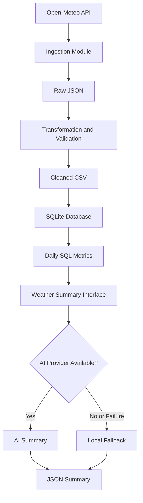

# Weather Data Ingestion Pipeline

A Python-based weather data ingestion pipeline that collects weather observations from a public API, validates and transforms the data, stores curated records in SQLite, calculates daily weather metrics, and generates a concise weather summary with an optional AI integration.

## 1. Project Overview

This project demonstrates a small, modular data engineering pipeline. It focuses on reliable data ingestion, data quality, structured storage, incremental loading, analytical SQL queries, automated testing, and a clear interface for AI-generated summaries.

### Objectives

- Retrieve weather observations from a public weather API.
- Preserve raw API responses for traceability.
- Clean and validate weather measurements.
- Remove duplicate records and handle invalid values.
- Store curated data in a relational database.
- Support repeatable ingestion using upserts.
- Calculate daily weather metrics using SQL.
- Generate a weather summary with a local fallback.
- Test normal behavior and important edge cases.

## 2. Technology Stack

- **Language:** Python
- **Data processing:** Pandas
- **Database:** SQLite
- **Data source:** Open-Meteo API
- **Testing:** Pytest
- **AI integration:** OpenAI API (optional)
- **Data formats:** JSON and CSV
- **Version control:** Git and GitHub

## 3. Architecture

The pipeline follows this sequence:

1. Fetch weather data from Open-Meteo.
2. Save the original API response as raw JSON.
3. Parse timestamps and transform the measurements.
4. Handle invalid values and duplicate observations.
5. Save the cleaned data and load records into SQLite.
6. Calculate daily weather metrics using SQL.
7. Generate a weather summary through the AI summary interface.
8. Save the summary as JSON and record pipeline execution status where configured.

### Data Flow



## 4. Project Structure

```text
weather-data-ingestion/
├── src/
│   ├── __init__.py
│   ├── ingest.py
│   ├── transform.py
│   ├── database.py
│   ├── metrics.py
│   ├── ai_summary.py
│   ├── run_ai_summary.py
│   └── main.py
├── data/
│   ├── raw/
│   └── processed/
├── sql/
│   ├── schema.sql
│   ├── queries.sql
│   └── pipeline_runs.sql
├── tests/
│   ├── test_pipeline.py
│   └── test_ai_summary.py
├── docs/
│   └── architecture.md
├── requirements.txt
├── pytest.ini
├── .gitignore
└── README.md
```

Generated database and data files may also exist locally, depending on how the pipeline is run.

## 5. Prerequisites

- Python 3.10 or later
- pip
- Git
- An internet connection for fetching current weather data

The Open-Meteo API is used as the public weather data source. The AI provider is optional; the local summary fallback can operate without an API key.

## 6. Installation

Clone the repository:

```bash
git clone https://github.com/Harsh5283/weather-data-ingestion.git
cd weather-data-ingestion
```

Create and activate a virtual environment.

**macOS/Linux:**

```bash
python3 -m venv .venv
source .venv/bin/activate
```

Install dependencies:

```bash
python -m pip install --upgrade pip
python -m pip install -r requirements.txt
```

If you intend to use the OpenAI integration, ensure `openai` is included in `requirements.txt` and install it in the active environment.

## 7. Running the Pipeline

Run the complete ingestion and processing pipeline:

```bash
python -m src.main
```

The pipeline retrieves weather data, saves the raw response, transforms the measurements, loads curated records into SQLite, generates daily metrics, and records execution status if that functionality is enabled in the current configuration.

### Generate a Weather Summary

```bash
python -m src.run_ai_summary
```

The summary is written to:

```text
data/processed/weather_summary.json
```

The output contains the city, date, generation method, and summary text.

## 8. Data Quality and Transformation

The transformation module is responsible for preparing the raw weather observations for analysis.

It handles:

- Timestamp parsing and removal of unusable timestamps.
- Numeric conversion of weather measurements.
- Invalid temperature and humidity values.
- Negative precipitation and wind measurements.
- Duplicate city-and-timestamp observations.
- Chronological ordering of the cleaned records.

The cleaned dataset is written to:

```text
data/processed/weather_clean.csv
```

Invalid measurements are represented as missing values where appropriate, rather than being treated as valid observations.

## 9. Database and Incremental Loading

SQLite provides persistent relational storage without requiring a separate database server.

The main `weather_records` table stores:

- City
- Observation timestamp
- Latitude and longitude
- Temperature
- Relative humidity
- Precipitation
- Wind speed
- Load timestamp

A unique constraint on `(city, time)` prevents duplicate observation keys. Upsert logic allows an existing observation to be updated when the pipeline encounters the same city and timestamp again.

The database schema is defined in `sql/schema.sql`.

Pipeline execution tracking is defined in `sql/pipeline_runs.sql`, where configured. It records execution status, record counts, and error information.

## 10. Daily Weather Metrics

The SQL aggregation calculates daily metrics for each city, including:

- Average, minimum, and maximum temperature
- Average relative humidity
- Total precipitation
- Average wind speed
- Number of observations

The query is maintained in `sql/queries.sql` and/or the metrics module, depending on the current implementation.

Generated metrics are written to:

```text
data/processed/daily_weather_metrics.csv
```

These aggregates provide a compact analytical view of the ingested observations.

## 11. AI Summary and Fallback

The AI summary component is isolated in `src/ai_summary.py`, keeping provider-specific logic separate from the rest of the pipeline.

When an OpenAI API key is configured, the component attempts to generate a concise summary based on the supplied metrics. If no key is configured or the provider call fails, the component generates a local fallback summary.

Set the API key in your terminal only if you want to test the live AI integration:

```bash
export OPENAI_API_KEY="your_api_key_here"
```

An optional model setting can be configured with:

```bash
export OPENAI_MODEL="gpt-4.1-mini"
```

Do not commit API keys, `.env` files containing secrets, or other credentials to version control. A live AI call may incur API charges.

## 12. Testing

Run the automated tests from the project root:

```bash
python -m pytest -q
```

The test suite is intended to cover transformation behavior, duplicate removal, invalid measurements, and AI fallback behavior.

Record the actual test result before submission. Do not describe the suite as passing unless the command completes successfully.

## 13. Error Handling and Reliability

The implementation includes or is designed to support:

- Retries for selected transient HTTP errors.
- Validation and cleaning before database loading.
- Upserts for repeatable ingestion.
- An AI fallback when the external provider is unavailable.
- Pipeline execution status and error logging where configured.

External API availability and network connectivity can affect ingestion runs.

## 14. Limitations and Future Improvements

Potential improvements include:

- Scheduling automatic daily ingestion.
- Adding structured logging and pipeline performance metrics.
- Supporting multiple cities through configuration.
- Adding data freshness and completeness checks.
- Expanding integration tests for API and database failures.
- Using a managed database for larger workloads.
- Adding a dashboard for daily weather metrics.

## 15. Author and Repository

**GitHub repository:**  
https://github.com/Harsh5283/weather-data-ingestion

This project was developed as part of a technical assessment focused on weather data ingestion, transformation, storage, and reporting.
