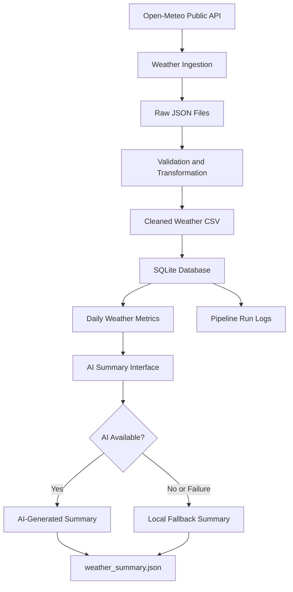

# Weather Data Ingestion — Architecture

## Overview

The pipeline fetches weather observations from the Open-Meteo API,
stores the raw response, validates and transforms the data,
loads curated records into SQLite, calculates daily metrics,
and generates a concise weather summary.

## Data Flow

## Main Components

- **Ingestion:** Retrieves weather data from Open-Meteo and saves the raw response.
- **Transformation:** Parses timestamps, converts measurements to numeric values, handles invalid measurements, and removes duplicate records.
- **Database:** Stores curated weather records in SQLite using a unique city-and-timestamp key.
- **Metrics:** Calculates daily temperature, humidity, precipitation, and wind metrics.
- **AI summary:** Uses an isolated summary interface with a local fallback if the provider is unavailable.
- **Testing:** Validates data transformation, duplicate handling, invalid measurements, and AI fallback behavior.

## Reliability

- Retries are configured for selected transient API errors.
- Database upserts support repeated ingestion without duplicate city/timestamp records.
- Invalid measurements are handled during transformation.
- AI provider failures fall back to a local summary.
- Pipeline run status and errors can be recorded in SQLite.
